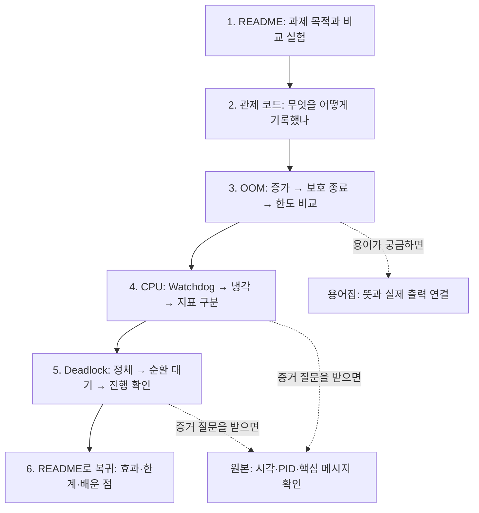

# 2026-11-10 장애 분석 실습: 발표와 학습 안내

이 폴더는 Linux 앱의 **메모리 문제·CPU 과점유·교착상태**를 로그와 관제 수치로 분석한 결과입니다. 환경변수 변경 전후를 비교해 Issue 구조의 보고서 3건으로 정리했습니다. Ubuntu에서 직접 명령을 실행했고 관제 코드·분석·문서 정리에 Codex의 도움을 받았습니다. 기존 10월 9일 자료와 구분한 이번 실습의 작업 위치는 **plus_2026_11_10/**입니다.

## 처음 오셨다면 여기부터

- **발표를 준비할 때:** 아래 [발표 순서와 말할 문장](#presentation)을 보고 화면을 이동합니다. [최종 메모](evaluation-final-memo.md) · [메모장용 최종 메모](evaluation-final-memo.txt)를 옆에 열어둡니다.
- **코드를 이해할 때:** 보고서의 “코드 해석” → “출력 해석”을 읽습니다. [monitor.sh 전체 코드 해설](monitor-code-guide.md)에는 관제 코드의 줄별 목적을 적었습니다.
- **단어가 낯설 때:** [용어집](glossary.md)을 엽니다. 보고서의 파란 용어를 누르면 해당 설명으로 바로 이동합니다. 예: [Current Heap](glossary.md#current-heap), [OS](glossary.md#os), [RSS](glossary.md#rss), [MemoryGuard](glossary.md#memoryguard), [한도 초과](glossary.md#memory-limit-exceeded).
- **원본을 확인할 때:** 보고서의 “증거 링크를 누르면 무엇을 보나요?” 표를 따라갑니다. 원본은 당시 출력이며 해설은 보고서에 따로 적었습니다.

이미 필수 실험 여섯 번을 마쳤으므로 발표 준비를 위해 앱을 다시 실행할 필요는 없습니다. 코드 블록은 당시 수집 구문의 요약 또는 별도로 표시한 확인 예시입니다. 과거 PID를 지금 조회해 당시 출력을 다시 얻을 수는 없습니다.

## 평가 때 설명할 순서도

순서도 아래의 파일 링크를 눌러 이동합니다. 발표는 약 7~10분으로 연습하되 실제 시간과 형식은 평가자의 안내를 따릅니다. 기본 설명은 보고서의 발췌 화면을 사용하고 원본은 질문에 근거를 보여줄 때 엽니다.

| 순서·열 화면 | 화면에서 가리킬 부분 | 말할 문장 |
|---|---|---|
| 1. 지금 보는 README | 첫 문단과 아래 실험 요약 | “Linux 앱의 세 장애를 로그와 관제 수치로 분석했습니다. 환경변수 변경 전후를 비교했고 직접 명령을 실행하며 결과를 확인했습니다.” |
| 2. [관제 코드](scripts/monitor.sh) · [코드 해설](monitor-code-guide.md) | ps 조회 → awk → 시간 → sleep | “작업 PID를 약 1초마다 조회해 RSS와 상태를 CSV로 남겼습니다. CPU의 짧은 변화는 top으로 추가 관측했습니다.” |
| 3. [OOM 보고서](reports/01-oom.md) | 1절 비교 표 → 2절 메모리 상승과 종료 로그 → 4절 | “한도를 128에서 256MB로 높이자 더 오래 생존했지만 같은 MemoryGuard 종료가 반복됐습니다. 증가 원인을 고친 것은 아니므로 임시 조치입니다.” |
| 4. [CPU 보고서](reports/02-cpu.md) | 2절 Watchdog → 냉각과 86초 → 70% 화면 → 4절 | “80 설정은 보호 종료됐고 40 설정은 냉각과 진행을 확인했습니다. top 최대는 70%여서 앱 설정과 OS 측정을 구분했습니다. 마지막은 수동 정리입니다.” |
| 5. [Deadlock 보고서](reports/03-deadlock.md) | 2절 두 스냅샷과 WAITING → 3절 순환 관계 → 4절 | “PID는 남았지만 작업이 정체됐고 두 워커가 상대 자원을 기다렸습니다. false 변경 후에는 로그가 늘고 작업이 진행했습니다.” |
| 6. README로 돌아오기 | 아래 분석의 한계 | “단일 수치 대신 설정·관제·로그를 연결했습니다. 조치 효과와 확인하지 못한 범위를 구분하고 원본을 보존했습니다.” |

### 1번 화면: README에서는 이렇게 시작하세요

**가리킬 곳:** 이 문서 첫 문단 → 아래 “실험 요약” 표. README에서 모든 명령어를 한꺼번에 설명하지 않아도 됩니다.

> 이 과제는 프로그램이 꺼졌다는 결과만 보는 것이 아니라 왜 문제가 생겼는지 증거로 판단하는 과제입니다. 저는 메모리, CPU, 교착상태를 각각 설정 변경 전후로 비교해 총 여섯 번 실행했습니다. 각 보고서는 현상, 증거, 원인 분석, 조치와 검증으로 구성했습니다. 절차와 코드·보고서 정리에는 Codex의 도움을 받았고, 제가 Ubuntu에서 직접 명령을 실행하며 실제 출력을 확인했습니다. 먼저 어떤 데이터를 수집했는지 보여드리겠습니다.

**왜 이렇게 시작하나요?** 평가자가 과제 목적, 본인의 수행 범위, 뒤에 볼 자료의 구성을 먼저 알 수 있기 때문입니다. 다음에는 [monitor.sh 해설](monitor-code-guide.md)의 “역할”과 “ps 필드”로 이동하세요.

### 보고서 하나를 설명하는 공통 순서

**현상 → 증거 → 원인 판단 → 조치 → 검증**입니다. 숫자를 읽은 다음 “그래서 어디까지 판단했는지”를 붙입니다. 예를 들어 “RSS가 늘었습니다”에서 끝내지 않고 “종료 로그도 확인해 MemoryGuard 보호 종료로 판단했습니다”라고 연결합니다.

## 실험 요약

| 보고서 | 바꾼 설정 | 확인한 결과 | 설명할 한계 |
|---|---|---|---|
| [01. OOM](reports/01-oom.md) | MEMORY_LIMIT 128 → 256MB | 로그 기준 17.185 → 32.355초, 같은 보호 종료 반복 | 메모리 증가 코드 수정이 아닌 종료 지연 |
| [02. CPU](reports/02-cpu.md) | CPU_MAX_OCCUPY 80 → 40 | Watchdog 종료 → 내부 냉각·86초 시점 생존과 진행 | **top 최대 50 → 70% 실측**, OS 상한 40% 보장 아님 |
| [03. Deadlock](reports/03-deadlock.md) | MULTI_THREAD_ENABLE true → false | 순환 대기·정체 → 10초 사이 로그 661바이트 증가·진행 | 관측 구간의 해당 교착 경로 회피 |

각 비교에서는 나머지 주요 설정을 유지했습니다. 비교 대상·기간·측정 방식은 보고서에 함께 적었습니다. 보고서의 재현 코드는 전체 입력 기록이 아닌 구문 요약이며 필요한 선행 변수·경로를 명시했습니다.

## 용어와 코드가 궁금할 때 여는 자료

| 궁금한 내용 | 읽을 곳 |
|---|---|
| Current Heap과 RSS는 왜 다르나요? | [Heap](glossary.md#current-heap) · [RSS](glossary.md#rss) · [단위](glossary.md#units) |
| MEMORY_LIMIT과 MemoryGuard는 같은 것인가요? | [설정 한도](glossary.md#memory-limit) · [보호 구성요소](glossary.md#memoryguard) · [한도 초과 로그](glossary.md#memory-limit-exceeded) |
| CPU 40인데 top 70%는 무슨 뜻인가요? | [앱 설정](glossary.md#cpu-max-occupy) · [Current Load](glossary.md#current-load) · [top](glossary.md#top) |
| monitor.sh는 왜 만들었나요? | [전체 코드와 줄별 해설](monitor-code-guide.md) |
| source·export·변수·출력 저장은 무슨 뜻인가요? | [환경변수](glossary.md#environment-variable) · [셸 문법](glossary.md#shell) |
| 프로세스가 있는데 왜 교착인가요? | [PID](glossary.md#pid) · [교착 조건](glossary.md#deadlock) · [대기 위치](glossary.md#futex) |
| 137과 143은 왜 나왔나요? | [종료 코드](glossary.md#exit-code) · [SIGTERM](glossary.md#sigterm) |

## 예상 질문과 메모장 자료

- [평가 발표 최종 메모](evaluation-final-memo.md) · [메모장용 최종 메모](evaluation-final-memo.txt): 발표 순서, 가리킬 부분, 말할 문장과 예상 답변.
- [장애별 질문 48개](evaluation-qa.md) · [메모장용](evaluation-qa.txt): OOM·CPU·Deadlock 각각 16개 문답.
- [평가 항목 1~4·개념 해설](evaluation-rubric-guide.md) · [메모장용](evaluation-rubric-guide.txt): 증거 요구사항, 도구, 원리와 운영 응용 질문.
- [화면을 보며 설명하는 기존 안내](assessment-quick-guide.md): 발표와 증거를 연결하는 보충 자료.

## 파일 역할과 증거 읽는 방법

| 위치 | 의미 | 클릭한 뒤 확인할 것 |
|---|---|---|
| [reports](reports/README.md) | 판단을 정리한 보고서 3건 | 코드 해석 → 출력 해석 → 판단 → 조치 효과 |
| evidence/각 실행 폴더/settings.txt | 실행하려고 지정한 세 설정 | 비교에서 한 변수만 바뀌었는지, 앱 부팅 로그와 일치하는지 |
| evidence/각 실행 폴더/app.log | 앱·PTY 출력 | PID·시각·한도 초과·종료·대기·후속 작업 |
| evidence/각 실행 폴더/monitor-번호.csv | PID별 OS 관제 수치 | timestamp와 rss_kib 추세, 부모·자식 구분 |
| evidence/CPU 폴더/top.log | 구간별 CPU 화면 | 작업 PID 행의 %CPU, 기록 기간과 표본 수 |
| evidence/Deadlock 폴더/snapshot-1·2.txt | 두 시점 상태를 함께 저장 | PID 유지, RSS·로그 크기·수정 시각, 자원 대기·진행 |
| evidence/각 실행 폴더/cleanup.log | 실험자가 보낸 종료 요청 | 보호 종료와 수동 정리 구분 |
| [scripts](scripts) | 당시 설정·관제 스크립트 | env.sh는 초기 설정, monitor.sh는 외부 조회 코드 |
| [measurements.json](measurements.json) | 원본에서 재계산한 요약 | 보고서와 수치 대조. 새로운 원본 측정으로 보지 않음 |
| [SHA256SUMS](SHA256SUMS) | 파일 해시 목록 | 복사·보존된 파일의 바이트 무결성 |

증거별 직접 링크와 읽을 항목은 각 보고서의 **“증거 링크를 누르면 무엇을 보나요?”** 표에 있습니다.

## 출처·검증·분석의 한계

원본 백업은 Windows의 `Downloads/agent-app-leak/results-practice-20261110-201641-S1mFK3`입니다. **evidence 원본 98개와 당시 env.sh·monitor.sh는 원본 백업과 바이트 대조했습니다.** 보고서 해설을 추가해도 원본 출력은 고치지 않습니다.

[env.sh](scripts/env.sh)는 초기 128/100/false 설정입니다. 실행별 적용값은 settings.txt와 앱 부팅 로그로 확인합니다. [환경 기록](environment-at-backup.txt)은 백업 시점인 20:16:42의 자료이며 장애 발생 순간의 RAM 상태가 아닙니다. 제공 바이너리의 디컴파일·리버스 엔지니어링은 수행하지 않았습니다.

이번 자료는 정확한 누수 코드 위치, 앱 CPU 임계 판단식, 70% 구간의 특정 원인, 모든 요청의 응답 지연과 무한 시간의 안정성을 확정하지 않습니다. **필수 여섯 비교 실행과 보고서 세 건은 정리했으며, 남은 준비는 본인 설명 연습과 실제 평가·제출 절차 확인입니다.**
