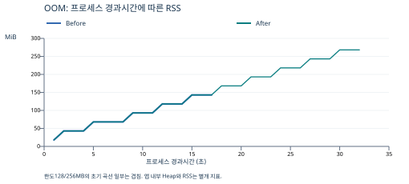

# [Bug] OOM Crash - MEMORY_LIMIT 초과 시 MemoryGuard 자체 종료

증거를 처음 읽는다면 [이 보고서의 증거 파일·출력 해설](../docs/evidence-reading-guide.md#2-oom-변경-전-128mb)을 먼저 보세요. 각 파일 링크 옆에 수집 이유와 출력 해석을 설명했습니다.

실험일: 2026-10-09 KST · 실행 계정: jae0608(UID 1000) · 환경: Ubuntu 26.04.1 LTS / WSL2 / x86_64

## 1. Description (현상 설명)

`agent-leak-app`을 일반 사용자로 실행하면 부팅 검사 6개가 모두 통과하지만, MemoryWorker의 메모리 값이 약 3초마다 25MB씩 증가하고 MemoryGuard 로그와 함께 종료됐습니다.

Before는 `MEMORY_LIMIT=128`, After는 `256`입니다. `CPU_MAX_OCCUPY=100`과 `MULTI_THREAD_ENABLE=false`를 동일하게 유지해 **메모리 설정 하나만 변경**했습니다.

| 항목 | Before | After |
|---|---|---|
| 설정 | 128 / 100 / false | 256 / 100 / false |
| 실제 작업 PID | 962 | 1156 |
| 시작 로그 | 11:32:59.967 | 11:37:40.809 |
| MemoryGuard 종료 요청 | 11:33:17.169 | 11:38:13.172 |
| 로그 기준 생존 시간 | 17.202초 | 32.363초 |
| 앱 내부 종료 시 메모리 | 150MB | 275MB |
| 최초 관측 RSS | 18,356KiB (17.926MiB) | 18,476KiB (18.043MiB) |
| 마지막 관측 RSS | 146,376KiB (142.945MiB) | 274,516KiB (268.082MiB) |
| 종료 코드 | 137 | 137 |

## 2. Evidence & Logs (증거 자료)

### 재현 경로

1. 필수 환경변수·디렉터리·키 파일을 준비하고 `15034` 포트가 비어 있는지 확인했습니다.
2. `source ./env.sh`로 초기 값을 적용해 128MB 케이스를 실행했습니다.
3. 부모 PID와 실제 작업을 수행하는 자식 PID를 각각 `monitor.sh`로 기록했습니다.
4. 종료 후 PID가 사라진 것을 `ps -C agent-leak-app`으로 확인하고 `wait`의 종료 코드를 저장했습니다.
5. `export MEMORY_LIMIT=256`만 변경하고 새 증거 폴더에 같은 절차를 반복했습니다.

```bash
source ./env.sh
export MEMORY_LIMIT=128       # After에서는 256으로 변경
export CPU_MAX_OCCUPY=100
export MULTI_THREAD_ENABLE=false
./agent-leak-app > "$RUN_DIR/app.log" 2>&1 &
APP_PID=$!
./monitor.sh "$APP_PID" > "$RUN_DIR/monitor-$APP_PID.csv" &
# pgrep -P "$APP_PID"로 자식 PID도 찾아 각각 관제했다.
```

### 관제 자료



128MB 케이스의 실제 CSV 발췌입니다. CPU 값은 `ps`의 누적 평균이며 RSS의 단위는 KiB입니다.

```csv
timestamp,pid,ppid,elapsed_s,cpu_avg_pct,mem_pct,rss_kib,threads,state
2026-10-09T11:33:01+09:00,962,954,1,2.0,0.2,18356,1,SN
2026-10-09T11:33:05+09:00,962,954,5,1.1,0.8,69564,1,SN
2026-10-09T11:33:11+09:00,962,954,12,0.9,1.5,120772,1,SN
2026-10-09T11:33:17+09:00,962,954,17,0.8,1.8,146376,1,SN
```

### 종료 로그

Before:

```text
2026-10-09 11:33:17,169 [INFO] [MemoryWorker] Current Heap: 150MB
2026-10-09 11:33:17,169 [CRITICAL] [MemoryGuard] Memory limit exceeded (150MB >= 128MB) / (Recommend Over 256MB)
2026-10-09 11:33:17,169 [CRITICAL] [MemoryGuard] Self-terminating process 962 to prevent system instability.
```

After:

```text
2026-10-09 11:38:13,171 [INFO] [MemoryWorker] Current Heap: 275MB
2026-10-09 11:38:13,172 [CRITICAL] [MemoryGuard] Memory limit exceeded (275MB >= 256MB) / (Recommend Over 256MB)
2026-10-09 11:38:13,172 [CRITICAL] [MemoryGuard] Self-terminating process 1156 to prevent system instability.
```

두 실험 모두 종료 후 `ps` 출력에는 다음 제목 행만 남았습니다.

```text
PID PPID ELAPSED %CPU %MEM RSS NLWP STAT
```

원본: [128MB 로그](../evidence/oom-128-20261009-113259/app.log) ([출력 해설](../docs/evidence-reading-guide.md#2-oom-변경-전-128mb)), [128MB CSV](../evidence/oom-128-20261009-113259/monitor-962.csv) ([출력 해설](../docs/evidence-reading-guide.md#2-oom-변경-전-128mb)), [256MB 로그](../evidence/oom-256-20261009-113740/app.log) ([출력 해설](../docs/evidence-reading-guide.md#3-oom-변경-후-256mb)), [256MB CSV](../evidence/oom-256-20261009-113740/monitor-1156.csv) ([출력 해설](../docs/evidence-reading-guide.md#3-oom-변경-후-256mb)). 설정·PID·종료 후 출력·종료 코드도 각 폴더에 보존했습니다.

## 3. Root Cause Analysis (원인 분석)

### 증거로 확인한 원인

메모리 증가와 종료가 두 번 재현됐고, 앱이 직접 `Memory limit exceeded`와 `Self-terminating process`를 기록했습니다. 따라서 **직접적인 종료 원인은 앱 내부 MemoryGuard 보호 정책**으로 판단합니다.

앱의 메모리 값은 25MB 단위로 증가하므로 128MB를 정확히 찍지 않고 125 → 150MB, 256MB는 250 → 275MB 단계에서 초과했습니다. 설정 범위를 벗어난 입력이나 부팅 실패가 아닙니다.

관측 기간에 누적 데이터를 회수하지 않는 메모리 누수 또는 데이터 보관 증가가 의심됩니다. 다만 비공개 바이너리만으로 특정 컬렉션이나 코드의 해제 누락 위치, 도달 불가능 객체의 발생을 확정하지 않았습니다.

### OS 동작 원리와 측정 구분

프로세스 주소 공간에는 코드·정적 데이터·힙·스택 등이 있습니다. 동적으로 생성하는 데이터의 증가가 힙 및 실제 상주 페이지의 증가로 나타날 수 있습니다. `RSS`는 물리 메모리에 상주하는 프로세스 메모리이며, 앱 내부 `Current Heap`과 같은 지표가 아닙니다. [ps 문서](https://man7.org/linux/man-pages/man1/ps.1.html)

1초 간격 관제는 마지막 25MB 할당 직후의 짧은 구간을 놓칠 수 있습니다. **142.945/268.082MiB는 관측 최대 RSS이지 실제 종료 순간의 절대 최대값이 아닙니다.**

종료 코드 137은 Bash의 `128+시그널 번호` 규칙에서 SIGKILL(9) 해석과 일치합니다. 종료 주체는 코드 숫자만이 아니라 MemoryGuard 로그로 판단했습니다. 커널 로그로 OOM Killer 발생을 입증한 실험은 아닙니다. [Bash 종료 상태 문서](https://www.gnu.org/s/bash/manual/html_node/Exit-Status.html)

누수가 지속되면 다른 프로세스에 줄 물리 메모리가 줄고, 페이지 회수·스왑이 늘어 시스템 지연으로 이어질 수 있습니다. 이번 종료는 전체 RAM 소진 전에 앱 설정 한도에서 발생했습니다.

## 4. Workaround & Verification (조치 및 검증)

`MEMORY_LIMIT`을 **128 → 256MB**로 상향했습니다. 생존 시간이 **17.202 → 32.363초**, 약 **15.161초 증가(1.88배)**했습니다.

그러나 두 번째 실행도 메모리가 증가하다 같은 정책으로 종료됐습니다. 이번 비교에서 한도 상향은 **종료를 지연한 임시 조치**입니다.

추가 제안은 데이터 보관량 제한, 캐시 만료·회수 정책, 작업 완료 후 참조 제거 및 소스 접근이 가능한 개발자의 할당 분석입니다. 실제 정상 시나리오(512 / 40 / false)에서는 별도 실험에서 `Memory Cache Flushed`와 `MEMORY RECOVERED`도 관측됐습니다. 여러 설정이 다른 별도 시나리오이므로 이를 이번 단일 변수 비교의 결과와 섞지 않습니다.
