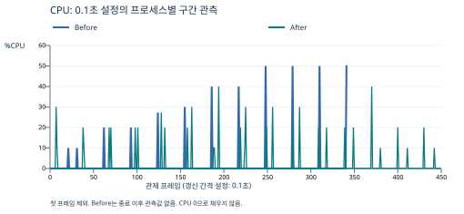

# [Bug] CPU Latency - 부하 증가 후 Watchdog 종료, CPU_MAX_OCCUPY=40으로 회피

증거를 처음 읽는다면 [이 보고서의 증거 파일·출력 해설](../docs/evidence-reading-guide.md#5-cpu-변경-전-80-설정)을 먼저 보세요. 각 파일 링크 옆에 수집 이유와 출력 해석을 설명했습니다.

실험일: 2026-10-09 KST · 환경: Ubuntu 26.04.1 LTS / WSL2 / x86_64

## 1. Description (현상 설명)

`MEMORY_LIMIT=512`, `MULTI_THREAD_ENABLE=false`에서 CPU 상한 설정을 80으로 실행하자 CpuWorker의 내부 부하 값이 증가한 뒤 Watchdog가 SIGTERM 보호 종료를 수행했습니다.

비교 실행은 `CPU_MAX_OCCUPY`만 **80 → 40**으로 바꿨습니다. 두 비교 실행 모두 PTY 출력 기록과 `top -d 0.1`을 사용했습니다.

| 항목 | Before: 80 | After: 40 |
|---|---|---|
| 작업 PID | 1921 | 2359 |
| 나머지 설정 | 512 / false | 512 / false |
| OS 구간 CPU 관측 최대 | 50.0% | 40.0% |
| 앱 내부 지표 | 53.11%에서 임계치 위반 | 40.00%에서 냉각 시작 |
| 종료/생존 | 시작 로그부터 36.380초 후 Watchdog 종료 | 55초 시점 PID·로그 진행 확인 |
| 최종 종료 코드 | 143, Watchdog SIGTERM | 143, 실험자 수동 SIGTERM |

최대값은 첫 `top` 프레임을 제외한 결과입니다. Before는 앱이 살아 있는 341개 구간 표본, After는 449개 표본입니다. 50%가 지속됐거나 노트북 전체 CPU의 50%였다는 의미가 아닙니다.

## 2. Evidence & Logs (증거 자료)

### 재현·수집 명령

```bash
source ./env.sh
export MEMORY_LIMIT=512
export CPU_MAX_OCCUPY=80       # After는 40
export MULTI_THREAD_ENABLE=false
script -q -e -f -c './agent-leak-app' "$RUN_DIR/app.log" \
  < /dev/null > "$RUN_DIR/console.log" 2>&1 &
SESSION_PID=$!
# 앱 PID는 pgrep -x agent-leak-app으로 별도로 찾았다.
TOP_PIDS=$(pgrep -x agent-leak-app | paste -sd, -)
LC_ALL=C top -b -d 0.1 -n 450 -w 180 -p "$TOP_PIDS" \
  > "$RUN_DIR/top.log" 2> "$RUN_DIR/top-error.log" &
```



### Before: 앱 로그

```text
2026-10-09 11:57:44,269 [INFO] Agent listening at port 15034
2026-10-09 11:57:46,280 [INFO] [CpuWorker] Current Load: 5.00%
2026-10-09 11:58:20,549 [INFO] [CpuWorker] Current Load: 53.11%
2026-10-09 11:58:20,649 [CRITICAL] [CpuWorker] CPU Threshold Violated! (53.11%).
>>> [SYSTEM] WATCHDOG: INITIATING EMERGENCY ABORT (SIGTERM) <<<
Script done on 2026-10-09 11:58:20+09:00 [COMMAND_EXIT_CODE="143"]
```

`top.log`에서 PID 1921의 0.1초 구간 최대 50.0%를 확인했고, 종료 후 `ps-check.txt`는 제목 행만 남았습니다.

### After: 냉각·생존 로그

```text
2026-10-09 12:21:08,526 [INFO] [CpuWorker] Peak reached (40.00%). Starting cooldown...
2026-10-09 12:21:33,450 [INFO] [CpuWorker] Cooldown complete (5.00%). Resuming load increase...
```

```text
2026-10-09T12:21:40+09:00
PID  PPID ELAPSED %CPU %MEM RSS    NLWP STAT
2359 2358 55      1.4  6.1  479420 3    SNl+
```

표의 행은 원본 `ps-check.txt`의 열을 읽기 쉽게 정렬한 것입니다. `%CPU=1.4`는 누적 평균이며, `top`의 구간 최대 40.0%와 측정 기간이 다릅니다.

### 추가 관측이 필요했던 이유

초기 80 설정의 1초 간격·30회 `top`에서는 최대 4.0%가 기록됐고, 기록은 11:48:00에 끝났습니다. 실제 종료는 11:48:05.646이었습니다. 짧은 버스트와 종료 직전 구간을 확인하기 위해 같은 80 설정으로 0.1초·450회 기록을 추가했습니다.

직접 파일로 출력한 초기 로그에는 Watchdog 문구가 없었지만, PTY로 재수집하자 SIGTERM 문구까지 확인됐습니다. Python 표준 출력의 터미널·파일 버퍼링 방식 차이와 일치하는 결과입니다. 버퍼링만이 유일한 원인이었다고 확정하지는 않았습니다. [Python 출력 설명](https://docs.python.org/3/library/sys.html#sys.stdout)

원본: [Before 로그](../evidence/cpu-80-pty-20261009-115744/app.log) ([출력 해설](../docs/evidence-reading-guide.md#5-cpu-변경-전-80-설정)), [Before top](../evidence/cpu-80-pty-20261009-115744/top.log) ([출력 해설](../docs/evidence-reading-guide.md#5-cpu-변경-전-80-설정)), [After 로그](../evidence/cpu-40-pty-20261009-122044/app.log) ([출력 해설](../docs/evidence-reading-guide.md#6-cpu-변경-후-40-설정)), [After top](../evidence/cpu-40-pty-20261009-122044/top.log) ([출력 해설](../docs/evidence-reading-guide.md#6-cpu-변경-후-40-설정)), [After 생존 확인](../evidence/cpu-40-pty-20261009-122044/ps-check.txt) ([출력 해설](../docs/evidence-reading-guide.md#6-cpu-변경-후-40-설정)).

## 3. Root Cause Analysis (원인 분석)

직접적인 종료 원인은 앱의 CpuWorker 임계치 위반과 **Watchdog의 SIGTERM 보호 조치**입니다. 내부 `Current Load`가 올라가는 동작과 실제 프로세스의 짧은 CPU 상승이 함께 관측됐습니다.

`CPU_MAX_OCCUPY=80`인데 내부 지표 53.11%에서 종료했으므로, 이 환경변수를 그대로 “OS CPU 사용률 80%를 넘으면 종료하는 임계치”로 해석하지 않습니다. 관측상 40 설정은 내부 부하 증가 상한·냉각 동작을 제어했고, 정확한 내부 보호 임계치 구현은 확인하지 않았습니다.

CPU를 사용하는 실행 가능 작업은 같은 CPU의 다른 작업과 실행 시간을 경쟁합니다. 버스트나 실행 대기 증가가 응답 시간을 늘릴 수 있습니다. 다만 이 실험은 **프로세스 CPU 상승과 보호 종료**를 검증했으며, 요청 지연 시간·P99 지연이나 시스템 전체 CPU 포화를 측정하지 않았습니다.

`ps %CPU`는 실행 이후 평균, `top %CPU`는 갱신 구간 기준입니다. 앱 내부 계산 값은 또 다른 지표입니다. 서로 대체해 적지 않았습니다. [ps](https://man7.org/linux/man-pages/man1/ps.1.html), [top](https://man7.org/linux/man-pages/man1/top.1.html)

## 4. Workaround & Verification (조치 및 검증)

`CPU_MAX_OCCUPY`를 **80 → 40**으로 낮췄습니다. After는 내부 40%에서 냉각됐고, 동일한 구간 관제의 최대값이 50.0 → 40.0%로 낮아졌습니다. Before 종료 시간보다 긴 **55초 시점에 PID와 진행 로그가 유지**됐습니다.

After 전체 로그에는 Watchdog/CPU 임계치 위반이 없고 마지막 종료는 `cleanup.log`의 수동 SIGTERM입니다. 두 실행 모두 종료 코드가 143이어도 원인은 다릅니다. 코드 숫자와 종료 로그·수동 조치 기록을 함께 판단합니다.

After의 장기 기록에는 벽시계와 `elapsed_s` 사이에 공백/차이가 있어, “약26분 동안 중단 없이 실행”처럼 확장해 주장하지 않습니다. 보고서의 기본 비교 범위는 명확한 초기 55초입니다.

근본 조치 제안은 CPU 작업량·동시성 제한, 배치 크기 및 휴지 구간 조절, 별도 부하/지연 벤치마크와 프로파일링입니다.
