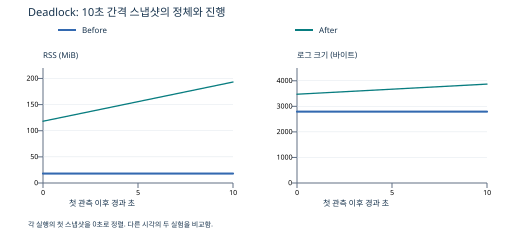

# [Bug] Deadlock - 상반된 락 획득 순서로 두 워커가 순환 대기

실험일: 2026-10-09 KST · 환경: Ubuntu 26.04.1 LTS / WSL2 / x86_64

## 1. Description (현상 설명)

`MEMORY_LIMIT=512`, `CPU_MAX_OCCUPY=40`을 유지하고 `MULTI_THREAD_ENABLE=true`로 실행하자 프로세스는 살아 있지만 로그와 메모리가 정체됐습니다. 두 워커는 각자 자원 하나를 보유하고 상대 자원을 기다렸습니다.

`MULTI_THREAD_ENABLE`만 `false`로 바꾼 After에서는 PID가 유지되고 작업·로그가 계속 진행됐습니다.

| 항목 | Before: true | After: false |
|---|---|---|
| 실제 작업 PID | 9226 | 11294 |
| 두 관측 시각 | 12:59:55 / 13:00:05 | 13:03:21 / 13:03:31 |
| PID 존재 | 두 시점 존재 | 두 시점 존재 |
| RSS | 18,512 → 18,512KiB | 121,000 → 197,812KiB |
| 로그 크기 | 2,792 → 2,792바이트 | 3,474 → 3,870바이트 |
| 스레드 | 세 스레드 모두 futex_do_wait | 메인 futex, 두 워커 poll 대기; 로그 진행 |
| 최종 종료 | 수동 SIGTERM | 수동 SIGTERM |

## 2. Evidence & Logs (증거 자료)

### 재현·관측 명령

```bash
source ./env.sh
export MEMORY_LIMIT=512
export CPU_MAX_OCCUPY=40
export MULTI_THREAD_ENABLE=true   # After는 false
script -q -e -f -c './agent-leak-app' "$RUN_DIR/app.log" \
  < /dev/null > "$RUN_DIR/console.log" 2>&1 &
SESSION_PID=$!

ps -ef | grep '[a]gent-leak-app'
ps -L -p "$WORKER_PID" -o pid,tid,pcpu,rss,time,stat,wchan:32,comm
stat -c 'log_bytes=%s modified=%y' "$RUN_DIR/app.log"
# 같은 명령을 10초 간격으로 두 번 기록했다.
```

### PID·스레드 대기 증거

13:00:05 원본 스냅샷의 작업 프로세스입니다.

```text
jae0608 9226 9225 0 12:59 pts/2 00:00:00 ./agent-leak-app
PID  TID  %CPU RSS   TIME     STAT WCHAN         COMMAND
9226 9226 0.1  18512 00:00:00 SNl+ futex_do_wait agent-leak-app
9226 9297 0.0  18512 00:00:00 SNl+ futex_do_wait agent-leak-app
9226 9298 0.0  18512 00:00:00 SNl+ futex_do_wait agent-leak-app
log_bytes=2792 modified=2026-10-09 12:59:52.286312863 +0900
```

동일한 RSS를 세 행만큼 합산하지 않습니다. 각 TID는 같은 프로세스의 주소 공간을 공유합니다. 로그의 Worker-Thread-1/2와 TID9297/9298의 개별 대응 정보가 없으므로 어느 TID가 어느 워커인지 확정하지 않았습니다.

### 마지막 로그와 순환 대기

```text
12:59:50,274 Worker-Thread-1 LOCK ACQUIRED: [Shared_Memory_A]. (Holding...)
12:59:50,275 Worker-Thread-2 LOCK ACQUIRED: [Socket_Pool_B]. (Holding...)
12:59:52,284 Worker-Thread-2 WAITING for [Shared_Memory_A]... (Status: BLOCKED)
12:59:52,286 Worker-Thread-1 WAITING for [Socket_Pool_B]... (Status: BLOCKED)
```

이 발췌는 원본에서 날짜와 공통 로그 접두사를 생략한 것입니다. 마지막 앱 로그는 12:59:52.286이며 두 스냅샷 사이에 파일 크기와 mtime이 변하지 않았습니다.



원본: [Before 로그](../evidence/deadlock-true-20261009-125943/app.log), [스냅샷1](../evidence/deadlock-true-20261009-125943/snapshot-1.txt), [스냅샷2](../evidence/deadlock-true-20261009-125943/snapshot-2.txt), [Before CSV](../evidence/deadlock-true-20261009-125943/monitor-9226.csv), [After 스냅샷1](../evidence/deadlock-false-20261009-130309/snapshot-1.txt), [After 스냅샷2](../evidence/deadlock-false-20261009-130309/snapshot-2.txt).

## 3. Root Cause Analysis (원인 분석)

대기 관계는 **Thread-1 → B(Thread-2 보유) → Thread-2 → A(Thread-1 보유) → Thread-1**입니다. 두 워커의 락 획득 순서가 반대이므로 한쪽이 자원을 반납하지 않으면 다른 쪽도 진행하지 못합니다. 메인도 워커 완료를 기다리는 로그와 대기 상태가 관측됐습니다.

| 교착상태 조건 | 정의 | 이번 관측과의 연결 |
|---|---|---|
| 상호 배제 | 자원을 한 작업만 소유 | A/B 각각의 LOCK ACQUIRED |
| 점유 대기 | 보유한 채 다른 자원을 기다림 | Holding 뒤 상대 자원 WAITING |
| 비선점 | 대기자가 다른 작업의 락을 강제 회수하지 못함 | 대기 중 락 해제·자동 회수 없음; 일반 락 모델로 추론 |
| 순환 대기 | 대기 관계가 고리를 형성 | T1은 B, T2는 A를 기다림 |

`futex_do_wait`는 커널 동기화 대기 상태와 부합합니다. 다만 futex 대기만으로 교착을 단정하지 않았습니다. **보유·추가 요청 로그, 순환 대기 관계, 진행 정체**를 함께 근거로 진단했습니다. 락 구현 종류·타임아웃 코드는 확인하지 않았습니다. [futex 문서](https://man7.org/linux/man-pages/man2/futex.2.html)

## 4. Workaround & Verification (조치 및 검증)

`MULTI_THREAD_ENABLE=true → false`로 변경하고 동일한 두 스냅샷 수집을 반복했습니다. After에서는 로그 크기가 **396바이트 증가**, RSS가 **76,812KiB 증가**했고 워커 진행 로그가 계속 발생했습니다. 관측한 10초 구간에서 해당 교착 경로가 회피됐습니다.

After에서도 메인 스레드의 futex 대기와 스레드 3개가 남았습니다. 정상 워커도 타이머·이벤트를 기다릴 수 있습니다. 설정 false를 프로그램 전체의 단일 스레드 전환으로 해석하지 않고, 로그와 워커 진행으로 회피를 확인했습니다.

두 실행은 증거 수집 후 수동 SIGTERM으로 정리했습니다. 원래 Deadlock은 프로세스가 스스로 종료된 장애가 아닙니다. 마지막 `exit-code.txt=143`은 정리 행위의 결과이며 `cleanup.log`가 이를 구분합니다.

근본 해결 제안은 모든 경로에서 A → B처럼 락 획득 순서 통일, 불필요한 중첩 락 제거, 타임아웃·롤백, 예외 발생 시 락 해제 보장입니다.
